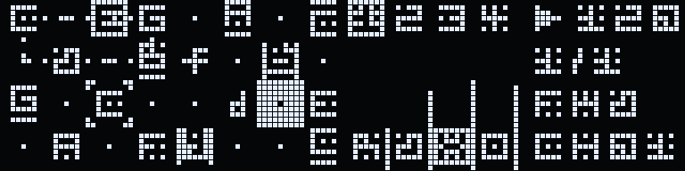
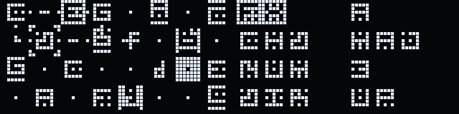
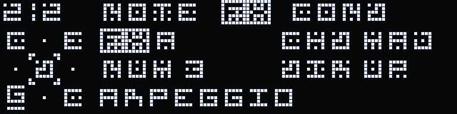

# MAZE

**Эзотерический тайловый секвенсер для [ESPidi](https://github.com/EugeneCarlo/ESPidi)** (ESP32-C3, OLED 128×32, энкодер, MIDI in/out).
Ставится в слот [ESPidi HUB](https://espidi-hub.github.io/).

[English](README.md)



На карте 4×8 рисуешь до четырёх маршрутов. Указатель идёт по каждому и играет ноту из тайла, на который наступил;
эффекты тайлов дают ретчеты, транспонируют, поворачивают карту и сдвигают ряды — паттерн всё время переписывает сам себя.
По мотивам KALEIDOSCOPE (Vadjuse) и ORCA; пиксельный шрифт Klaatu — из прошивки KALEIDOSCOPE.

## Возможности

- **Карта 4×8, 4 маршрута, 4 указателя.** Маршрут — до 16 клеток, рисуется энкодером, путь между точками — кратчайший.
  Открытый маршрут играет LOOP, PONG или REV, замкнутый — FWD или REV.
- **У маршрута:** скорость 2/1 · 1/1 · 1/2 · 1/4 · 1/8 (1/1 — шестнадцатые), MIDI-канал, velocity и длина ноты по умолчанию, мьют.
- **Тайл:** нота C…B с диезами (или пусто), октава 2–8, velocity, длина, один эффект и его условие.
- **Лад (скейл-энжин):** тоника и лад у проекта — MAJ MIN DOR PHR LYD MIX LOC HMIN MMIN PMAJ PMIN или CHRM (выключен).
  На карте и в звуке нота приводится к ближайшей в ладу; записанная нота хранится, так что от смены лада туда-обратно ничего не уползает.
  Новые ноты ставятся только из лада. **I** считает ступенями, **A** строит аккорды по ладу.
- **16 эффектов.**
  - MIDI: **A** арпеджио, **R** ретчет, **X** акцент, **P** афтертач, **I** интервал, **L** легато.
  - Карта (тайлы переезжают): **O** поворот 8 соседей, **Z** сдвиг ряда, **V** сдвиг столбца.
  - Указатель: **D** разворот, **W** стоп молча, **T** стоп со звуком, **S** скорость на ступень, **H** прыжок.
  - Тональность (вся фраза): **K** — новая тоника с начала следующего такта, **M** — сдвиг на N ступеней лада сразу.
    Маршруты с KEY OFF в настройках не трогаются (ударные); звучащая тоника вспыхивает в панели.
- **Условия:** IF — PASS (указатель пришёл), MEET (два указателя на тайле), NEAR (указатель по соседству), CHNG (соседа сдвинули);
  TRG — как у Elektron: A:B (1:2…8:8), PRE, /PRE.
- **32 слота проектов** во флеше. Сохраняется исходная карта, а не результат эффектов, — LOAD возвращает её.
  Черновик сохраняется сам; LOAD во время игры ждёт начала такта.
- **5 демо-проектов** в слотах 01–05, идут с прошивкой: MIX, MIDI (эффекты ноты), MAP (карта переписывает себя),
  COND (условия и счёт), POINTER (эффекты указателя и прогрессия E → A → B → E по 4 такта). Пишутся только в пустые слоты, твои проекты не трогаются.
- **Транспонирование с MIDI IN:** клавиатура или другой секвенсор двигают всю фразу, как **K**, но сразу.
  Защёлкой, с октавами (дом — тоника проекта в 4-й октаве), из зажатых — нижняя. Канал входа (IN: OFF, ALL, 1–16)
  — настройка устройства, не проекта. Сами ноты с MIDI IN не звучат.
- **Синхронизация:** свой клок с MIDI clock на выход или ведомый по клоку на MIDI IN — автоматически (EXT); старт — с ближайшего шага.




## Управление

TAP — модификатор. «Удерживать» — пока не заполнится шкала на экране.

| Органы | На карте | В других экранах |
|---|---|---|
| Энкодер | курсор по X | значение / шаг / слот |
| TAP + энкодер | курсор по Y | выбор параметра |
| Кнопка энкодера | правка тайла | — |
| Удерживать кнопку энкодера | стереть тайл | в линии: стереть цепь маршрута |
| TAP + кнопка энкодера | рисовать маршрут от курсора: нажатие — точка, двойное — готово, PLAY — отмена | — |
| TAP + TAP | старт / пауза | |
| PLAY | следующий маршрут (1→4) | |
| Удерживать PLAY | мьют маршрута | |
| TAP + PLAY | настройки маршрута: скорость, конец, канал, velocity, длина, KEY (следовать K и M) | |
| PAGE | карта ↔ маршрут в линию (правка тайла отсюда — с соседями 3×3 и подсказкой) | страницы NOTE → FX → COND |
| PAGE + энкодер | темп | |
| TAP + PAGE | проекты | |

**Экран проектов:** TAP + энкодер — слот; энкодер — выбранное поле (тоника, лад, канал MIDI IN или темп, справа);
TAP + PAGE — следующее поле; удерживать кнопку — LOAD, удерживать TAP + кнопку — SAVE; PAGE или PLAY — назад.

## Установка

На [espidi-hub.github.io](https://espidi-hub.github.io/) выбери слот, вкладка GitHub, вставь `Cirocular-Vlasenko-Daniil/MAZE`.
Или установщиком из репозитория [ESPidi-HUB](https://github.com/Cirocular-Vlasenko-Daniil/ESPidi-HUB):

```bash
python3 tools/espidi_hub.py install -p /dev/cu.usbmodem1101 --slot 2 Cirocular-Vlasenko-Daniil/MAZE
```

## Сборка

Только с **`FlashMode=dio`**: загрузчик HUB держит флеш в DIO, и сборка в QIO не читает свой флеш (проекты не сохранятся).

```bash
arduino-cli compile --fqbn esp32:esp32:esp32c3:PartitionScheme=huge_app,FlashMode=dio \
  --library path/to/ESPidi-HUB/sdk/ESPidiHub --output-dir build MAZE
```

Workflow `.github/workflows/firmware.yml` собирает каждый пуш и публикует `espidi/MAZE.ino.bin`, когда меняется версия в `ESPIDI_FIRMWARE()`.

Подробно о решениях, устройстве и бэклоге — [docs/DESIGN.md](docs/DESIGN.md).

## Лицензия

Код — MIT, см. [LICENSE](LICENSE). Шрифт Klaatu (`assets/font/`, таблицы глифов в `MAZE/maze_assets.h`) — Merih Yanbasti,
используется с разрешения и под MIT не подпадает.
